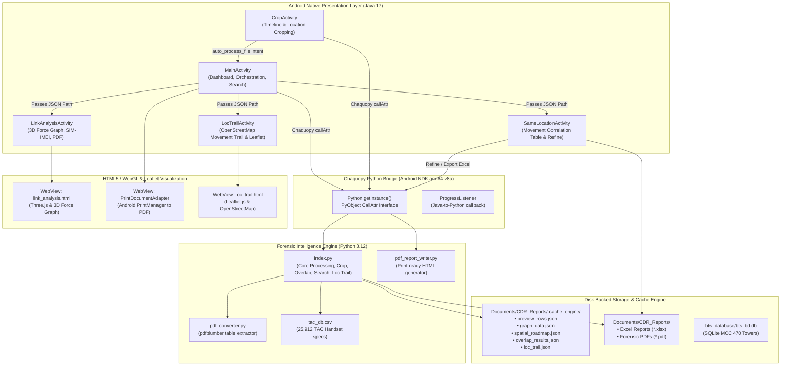
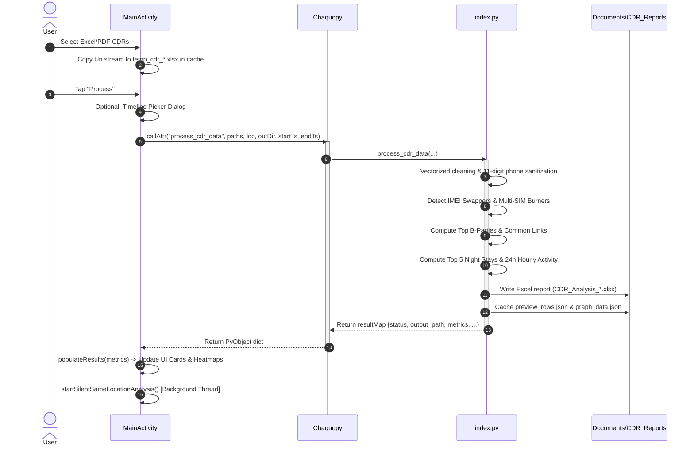
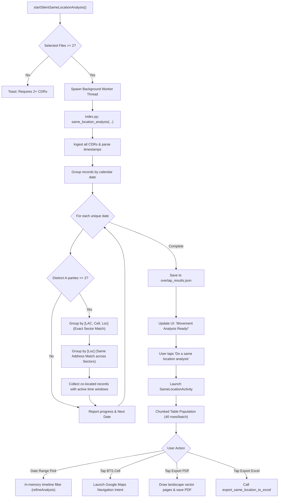
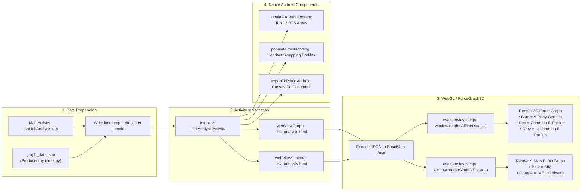
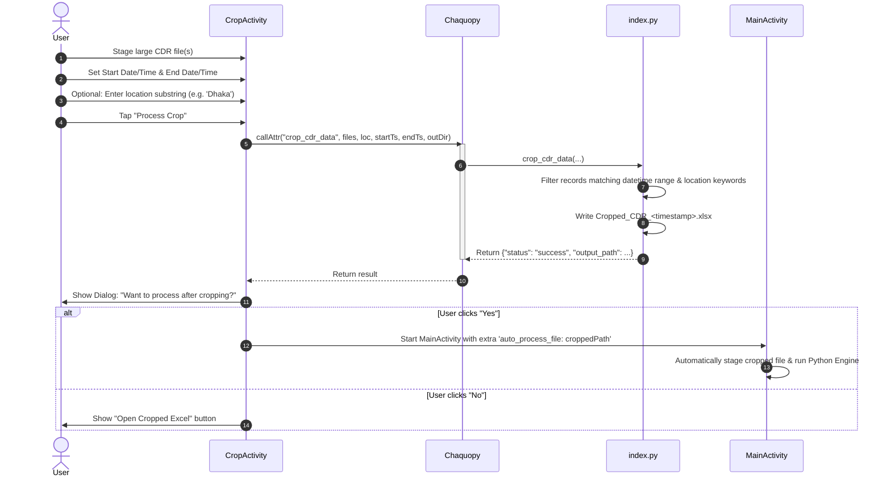
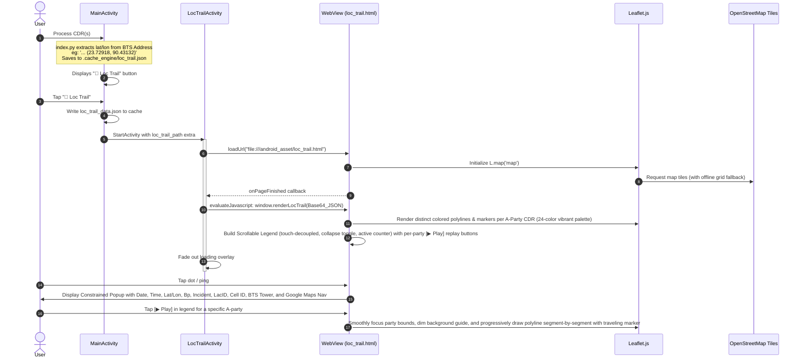

# Offline CDR Analyzer - Comprehensive Codebase Architecture & Flowchart Graph

> **Document Version:** 1.0.0  
> **Target Environment:** Android SDK 35 (Java 17) + Chaquopy (Python 3.12, ARM64-v8a) + WebView (Three.js / 3D Force Graph)  
> **Last Updated:** October 2026  
> **Purpose:** Permanent architectural graph, file inventory, and flowcharts. This document maps every single component, data structure, Chaquopy IPC interface, and execution flow across the entire codebase to serve as an authoritative reference for all future tasks.

---

## 1. High-Level System Architecture

The **Offline CDR Analyzer** is a multi-tier forensic intelligence application designed for Android devices to analyze Call Detail Records (CDRs) 100% offline with zero data leakage. It bridges native Android Java with an embedded Python 3.12 analytics engine via Chaquopy and renders 3D link graphs via HTML5/WebGL WebViews.



---

## 2. Complete Codebase File Catalog

| File Path | Language / Type | Size / Lines | Key Responsibilities |
| :--- | :--- | :--- | :--- |
| `app/src/main/AndroidManifest.xml` | XML Config | 71 lines | Application manifest, permissions (Storage, Location, Internet), Activity orientations, FileProvider config, intent queries (`geo:`, Google Maps, Excel MIME). |
| `app/build.gradle.kts` | Kotlin Gradle | 76 lines | App module build config, SDK 35, Min SDK 26, Chaquopy 3.12 setup, Pip packages (`pandas`, `numpy`, `openpyxl`, `pdfplumber`, `thefuzz`), NDK `arm64-v8a` ABI filter. |
| `app/src/main/java/.../MainActivity.java` | Java 17 | 1,464 lines | Primary application controller. File ingestion, timeline picker, Chaquopy job execution, result card metrics, temporal heatmaps, silent background correlation trigger, global CDR search, peek preview table, PDF printing. |
| `app/src/main/java/.../CropActivity.java` | Java 17 | 248 lines | Filter and crop large CDR sheets by datetime range and location substrings; exports standalone `.xlsx` and offers instant handoff to `MainActivity`. |
| `app/src/main/java/.../LinkAnalysisActivity.java` | Java 17 | 585 lines | Visualizes subscriber link relations and SIM-to-IMEI mapping using dual WebViews; populates area clusters with Google Maps intents; exports multi-page vector PDF via Android Canvas. |
| `app/src/main/java/.../SameLocationActivity.java` | Java 17 | 599 lines | Displays cellular tower co-location overlaps; provides in-memory datetime refinement without re-reading source disks; exports to PDF or Excel. |
| `app/src/main/java/.../LocTrailActivity.java` | Java 17 | 185 lines | OpenStreetMap location movement trail activity using Leaflet.js. Plots chronological GPS dots and polylines with detailed click tooltips and step-by-step movement replay animation. |
| `app/src/main/python/index.py` | Python 3.12 | 575 lines | Main forensic engine. Extracts lat/lon from BTS address brackets, processes CDRs, same location analysis, crop, search, export same location, TAC hardware lookup. |
| `app/src/main/python/pdf_converter.py` | Python 3.12 | 86 lines | Uses `pdfplumber` to extract tables from PDF CDRs and normalizes them into standard 13-column CDR structure. |
| `app/src/main/python/pdf_report_writer.py` | Python 3.12 | 171 lines | Builds print-ready forensic HTML with pagination, metadata tables, heatmap bars, link insights, handset indexes, and telemetry logs. |
| `app/src/main/python/tac_db.csv` | CSV Dataset | 25,912 rows | Database mapping 8-digit TAC codes to phone manufacturer and model. |
| `app/src/main/python/for_desktop/index.py` | Python 3.12 | 585 lines | Desktop counterpart engine with `calamine` engine support, loc_trail extraction, and OS user-cache path resolution. |
| `app/src/main/assets/loc_trail.html` | HTML5 / Leaflet | 520+ lines | Location movement trail on OpenStreetMap. Plots all CDR trails statically on load; features 24-color distinct palette; vertically scrollable touch-decoupled legend with active count badge and collapsible toggle; animates progressive polyline drawing and auto-centers area on Play; responsive non-overshooting popup cards with Bp, Incident, LacID, Cell ID, and Google Maps navigation. |
| `app/src/main/assets/leaflet.js` | JavaScript | Vendor Lib | Leaflet mapping library for offline embedded map rendering. |
| `app/src/main/assets/leaflet.css` | CSS | Vendor Lib | Leaflet map stylesheet. |
| `app/src/main/assets/link_analysis.html` | HTML5 / JS | 242 lines | WebGL 3D Force-Directed Graph application using Three.js and 3d-force-graph.js. Exposes `window.renderOfflineData` and `window.renderSimImeiData`. |
| `app/src/main/assets/3d-force-graph.min.js` | JavaScript | Vendor Lib | 3D Force-Directed Graph WebGL library. |
| `app/src/main/assets/three.min.js` | JavaScript | Vendor Lib | Three.js 3D graphics rendering engine. |
| `bts_database/download_and_build_bts_db.py` | Python 3 | 147 lines | CLI tool to download OpenCellID Bangladesh data (MCC 470) or ingest operator Excel files into SQLite `bts_bd.db`. |
| `bts_database/bts_bd.db` | SQLite 3 | Binary DB | Offline database indexed on `(lac, cell_id)` and `(lat, lon)` for instant BTS geographic lookup. |
| `bts_database/README.md` | Markdown | 29 lines | Documentation for creating and updating `bts_bd.db`. |
| `app/src/main/res/layout/activity_main.xml` | Android XML | 557 lines | Complete dashboard layout: staged files, location input, process buttons, btnLocTrail, intelligence card, heatmaps, badges, action buttons, full-screen animated loader. |
| `app/src/main/res/layout/activity_loc_trail.xml` | Android XML | 85 lines | Location movement trail layout with top toolbar, full-screen WebView, and animated loader. |
| `app/src/main/res/layout/activity_crop.xml` | Android XML | ~150 lines | Crop activity layout with date/time selectors, location field, process button, and status display. |
| `app/src/main/res/layout/activity_link_analysis.xml` | Android XML | ~180 lines | Layout with dual WebViews, area histogram container, and hardware mapping list. |
| `app/src/main/res/layout/activity_same_location.xml` | Android XML | ~160 lines | Landscape table layout with timeline refinement bar and export action buttons. |
| `app/src/main/res/layout/dialog_peek.xml` | Android XML | 101 lines | Dual-axis scrollable table layout for top 100 B-party preview rows. |
| `app/src/main/res/layout/item_histogram_bar.xml` | Android XML | ~40 lines | Single row layout for area cluster histogram bars. |
| `app/src/main/res/menu/main_menu.xml` | Android XML | 20 lines | Overflow menu: "📍 Loc Trail", "Save All As PDF", "About Me", "Check for update". |
| `app/src/main/res/xml/file_paths.xml` | Android XML | 5 lines | FileProvider paths configuration allowing sharing from internal cache and external Documents. |
| `app/src/main/res/values/strings.xml` | Android XML | 79 lines | Localized UI strings, Bengali welcome notes, error messages, and forensic descriptions. |

---

## 3. Detailed Component & Class Breakdown

### 3.1 `MainActivity.java`
* **Package:** `com.example.offlinecdranalyzer`
* **Inherits:** `androidx.appcompat.app.AppCompatActivity`
* **Lifecycle & State Variables:**
  - `selectedFilePaths` (`List<String>`): Staged file paths copied into app cache (`temp_cdr_*`).
  - `lastGeneratedReportPath` (`String`): Absolute path to the generated Excel report.
  - `lastGraphData` (`String`): Cached JSON string representing link graph and node profiles.
  - `lastSameLocationJson` (`String`): Path to disk cache `overlap_results.json`.
  - `lastSpatialSummary` (`String`): Plain text summary of spatial co-locations.
  - `lastPreviewJson` (`String`): JSON string of top 100 preview rows.
  - `lastSummaryHtml` (`String`): Formatted HTML summary of intelligence metrics.
  - `filterStartCal`, `filterEndCal` (`Calendar`): Optional datetime filters.
  - `backgroundAnalysisThread` (`Thread`): Worker thread running silent movement analysis.
  - `isAnalysisReady`, `isAnalysisRunning`, `isWaitingForAnalysis` (`boolean`): State flags for co-location readiness.
  - `INACTIVITY_TIMEOUT` (`30 * 60 * 1000 ms`): Auto-clears app state after 30 minutes of idle time.
* **Key Methods:**
  - `onCreate(Bundle)`: Initializes immersive full-screen mode (`WindowInsetsController`), starts Python runtime via `Python.start(new AndroidPlatform(this))`, purges cache, sets event listeners.
  - `runPythonEngine()`: Gathers inputs, launches thread, calls `index.py:process_cdr_data`, triggers `populateResults()` on success, and fires `startSilentSameLocationAnalysis()`.
  - `startSilentSameLocationAnalysis()`: Non-blocking background worker that calls `index.py:same_location_analysis` with progress callbacks. Updates progress bar and notifies user when ready.
  - `populateResults(Map<PyObject, PyObject>)`: Parses Python metrics, populates UI cards, builds collapsible night stays accordion (`renderNightStaySegments`), renders 24-hour heatmaps (`renderTemporalHeatmap`).
  - `performCdrSearch(String)`: Launches thread to call `index.py:search_cdr_data`, displays matches in `showSearchResultsDialog`.
  - `showPeekDialog()`: Loads `preview_rows.json` in chunks of 50 rows into a dual-axis scrollable `TableLayout` after a smooth 2.5s simulated loading sequence.
  - `generatePdfReport()`: Invokes `pdf_report_writer.py:generate_case_report_html` and feeds the result to `printHtmlToPdf` using Android `PrintManager`.
  - `openExcelFile(String)`: Dispatches `ACTION_VIEW` intent with `FileProvider` URI for `application/vnd.openxmlformats-officedocument.spreadsheetml.sheet`.
  - `handleAutoProcessIntent(Intent)`: Handles handoff from `CropActivity`.

### 3.2 `CropActivity.java`
* **Package:** `com.example.offlinecdranalyzer`
* **Purpose:** Targeted filtering and cropping of massive CDRs before main ingestion.
* **Key Fields:** `startCal`, `endCal`, `selectedFiles`, `cropLocationInput`, `lastCroppedPath`.
* **Key Methods:**
  - `showDatePicker()`, `showTimePicker()`: Configure timeline range.
  - `runCropEngine()`: Calls `index.py:crop_cdr_data(file_paths, location, start_ts, end_ts, out_dir)` on background thread.
  - `showProcessDialog()`: Prompts user: *"Want to process after cropping?"*; if Yes, launches `MainActivity` with `Intent.FLAG_ACTIVITY_CLEAR_TOP` and extra `auto_process_file: lastCroppedPath`.

### 3.3 `LinkAnalysisActivity.java`
* **Package:** `com.example.offlinecdranalyzer`
* **Purpose:** Multi-dimensional visualization of contacts, hardware hopping, and geographic footprint.
* **Key Components:**
  - Primary `WebView` (`webViewGraph`): Loads `file:///android_asset/link_analysis.html`, injects Base64 JSON, calls `window.renderOfflineData(...)`.
  - Secondary `WebView` (`webViewSimImei`): Loads `file:///android_asset/link_analysis.html`, calls `window.renderSimImeiData(...)`.
  - `populateAreaHistogram(String json)`: Builds interactive bars for top 12 BTS areas. Tapping an area fires `openGoogleMaps(String address)`.
  - `populateImeiMapping(String json)`: Displays subscribers with multiple IMEI handset profiles and hardware descriptions.
  - `exportToPdf(WebView)`: Uses `android.graphics.pdf.PdfDocument` to manually render multi-page vector PDF containing Common B-Parties and SIM-to-IMEI correlation tables.

### 3.4 `SameLocationActivity.java`
* **Package:** `com.example.offlinecdranalyzer`
* **Purpose:** Landscape correlation grid showing exact sector and tower address matches between multiple A-parties.
* **Key Components:**
  - `locTable` (`TableLayout`): Asynchronously populated in chunks of 40 rows.
  - BTS Location links: Tapping opens Google Maps navigation (`google.navigation:q=...`).
  - Timeline Refinement (`refineAnalysis()`): Filters `originalRawJson` in-memory by user-selected start/end timestamps without re-reading source files.
  - `exportToPdf()`: Draws landscape A4 vector pages (`842 x 595 pt`) with intelligent multi-line text wrapping for addresses and co-located A-parties.
  - `exportToExcel()`: Calls `index.py:export_same_location_to_excel` to generate styled Excel report.

### 3.5 `LocTrailActivity.java`
* **Package:** `com.example.offlinecdranalyzer`
* **Inherits:** `androidx.appcompat.app.AppCompatActivity`
* **Purpose:** Displays interactive movement route of A-parties on an OpenStreetMap map with Leaflet.js.
* **Key Components:**
  - `webViewLocTrail` (`WebView`): Loads `file:///android_asset/loc_trail.html`.
  - Leaflet integration: Injects Base64 encoded `loc_trail.json` to execute `window.renderLocTrail(...)`.
  - Multi-CDR Support: Distinct vibrant 24-color palette (`PARTY_PALETTE`) allowing 19+ concurrent suspect CDRs to each have unique color-coded polylines and markers.
  - Vertically Scrollable Legend: Card container with `.legend-list` supporting smooth touch scrolling (`overflow-y: scroll`, `touch-action: pan-y`, `-webkit-overflow-scrolling: touch`) decoupled from Leaflet map touch drag via `L.DomEvent.disableScrollPropagation` and `disableClickPropagation`.
  - Legend Header Controls: Interactive collapse/expand toggle (`▼ / ▲`) and active target counter badge (`X Active`).
  - Static Load & Area Focus: All routes and pings render statically on initial open; clicking [▶ Play] focuses and auto-centers the target party's bounds.
  - Progressive Drawing Animation: Progressively draws the polyline and moves a pulsing traveling marker with live tooltip; supports Pause / Resume / Finish.
  - Constrained Forensic Popups: Non-overshooting cards (approx. 60-62vw) displaying Date, Time, Lat/Lon, Bp (Party B), Incident (Usage Type), LacID, Cell ID, BTS address, and direct Google Maps navigation button.
  - Google Maps Intent: Intercepts `google.com/maps` URLs to launch native navigation.
  - Inactivity Timeout: 30-minute auto-expiry security guard.

---

## 4. Python Forensic Engine Breakdown (`app/src/main/python/`)

### 4.1 `index.py`
* **`lookup_imei(imei)`**:
  - Extracts 8-digit Type Allocation Code (`str(imei)[:8]`).
  - Looks up in cached `TAC_DICT` loaded from `tac_db.csv`.
  - Returns `"{Manufacturer} {Model}"` or `None`.
* **`process_cdr_data(file_paths, intended_location, output_dir, start_ts, end_ts)`**:
  1. *Ingestion:* Reads `.xlsx` via `openpyxl` with dynamic header row scanning (skipping banner/title rows 0..3) or `.pdf` via `pdf_converter.pdf_to_dataframe`.
  2. *Standardization & Coordinate Parsing:* Assumes 12+ column structure. Restores stripped leading zeros (`17...` $\to$ `017...`) and standardizes phone numbers. Tolerantly extracts latitude and longitude from BTS tower addresses using bracketed patterns `(...)`, `[...]`, `{...}`, or plain Bangladesh coordinate fallback boundaries. Saves sorted chronological records to `.cache_engine/loc_trail.json` supporting 19+ concurrent CDR files.
  3. *Timeline Masking:* Filters by `_parsed_dt` if `start_ts` and `end_ts` provided.
  4. *Hardware Forensics:*
     - Detects **IMEI Swappers**: A-parties associated with $\ge 3$ distinct IMEIs.
     - Detects **Multi-SIM Burners**: IMEIs associated with $\ge 3$ distinct A-party phone numbers.
  5. *Spatial Roadmap:* Compresses sequential events at the same tower into contiguous movement blocks with stay durations (`hh mm`). Cached to `spatial_roadmap.json`.
  6. *Frequency & Link Analysis:* Counts B-party frequencies. Identifies common contacts (`col_D` called by $>1$ distinct `col_C`).
  7. *Night Routine:* Filters calls between 22:00 and 05:59. Calculates top 5 night-stay towers per A-party.
  8. *Hourly Distribution:* Compiles 24-hour activity histograms for each A-party.
  9. *Disk Caching:* Saves heavy structures to `<output_dir>/.cache_engine/` (`preview_rows.json`, `graph_data.json`).
  10. *Excel Generation:* Saves formatted multi-sheet workbook (`Summary` and `Data`) in `Documents/CDR_Reports/`.
* **`same_location_analysis(file_paths, output_dir, start_ts, end_ts, progress_callback)`**:
  - Groups records by calendar date. Skips dates with $<2$ active A-parties.
  - **Match 1 (Exact Sector):** Group by `[LAC, Cell, Loc]`. If $\ge 2$ unique A-parties exist in group, logs overlap window.
  - **Match 2 (Same Address):** Group by `Loc`. Catches co-locations across different sectors or towers with identical site addresses.
  - Calls `progress_callback.onProgress(pct)` after each date processed.
  - Caches sorted results to `overlap_results.json`.
* **`crop_cdr_data(file_paths, location_query, start_ts, end_ts, output_dir)`**:
  - Applies datetime boundaries and comma-separated case-insensitive location filters.
  - Outputs `Cropped_CDR_<timestamp>.xlsx`.
* **`search_cdr_data(file_paths, search_query)`**:
  - Searches comma-separated query terms across all columns of all staged CDRs.
  - Returns HTML summary listing matching suspect A-parties and hit counts.
* **`export_same_location_to_excel(json_data, output_path)`**:
  - Converts co-location JSON into styled Excel sheet `"Co-Location Matrix"` with auto-adjusted column widths.

### 4.2 `pdf_converter.py`
* **`pdf_to_dataframe(pdf_path)`**:
  - Opens document using `pdfplumber.open(pdf_path)`.
  - Iterates pages and extracts tables (`page.extract_tables()`).
  - Eliminates header noise (rows containing "start", "party").
  - Maps tabular cells to 13 standard columns:
    `[0:Start, 1:B_Empty, 2:Party A, 3:Party B, 4:Call Duration, 5:Usage Type, 6:Call Type, 7:Lac ID, 8:Cell ID, 9:IMEI, 10:K_Empty, 11:Bts Address, 12:M_Empty]`.

### 4.3 `pdf_report_writer.py`
* **`generate_case_report_html(...)`**:
  - Receives case metadata, intelligence summary, graph JSON, and co-location JSON.
  - Generates HTML with standard `@page { size: A4; margin: 1.2cm 1.0cm; }`.
  - Renders 24-hour heatmaps with color interpolation (Green $\to$ Yellow $\to$ Red).
  - Renders tabular sections for Link Correlations, Subscriber SIM Index, Handset Core Index, Telemetry Preview (top 100), and Co-Location Interceptions.

---

## 5. End-to-End Workflow Flowcharts

### Workflow 1: Main CDR Analysis Pipeline


### Workflow 2: Movement & Co-Location Correlation


### Workflow 3: Link Analysis & 3D WebGL Graph


### Workflow 4: CDR Cropping Pipeline


### Workflow 5: Location Movement Trail Visualization (OpenStreetMap)


---

## 6. Data Contracts & Bridge Schemas

### 6.1 Standard CDR Column Mapping (12 / 13 Columns)
| Column Index | Field Name | Description | Sanitization Rules |
| :---: | :--- | :--- | :--- |
| **0 (A)** | `Start_Time` | Call/Event initiation timestamp | Converted via `pd.to_datetime(errors='coerce')` |
| **1 (B)** | `B_Empty` | Reserved / empty field | Replaced with `--Empty--` |
| **2 (C)** | `Party_A` | Subscriber / Calling mobile number | Stripped of `+88` or non-digits; sliced to last 11 digits |
| **3 (D)** | `Party_B` | Recipient / Called mobile number | Stripped of `+88` or non-digits; sliced to last 11 digits |
| **4 (E)** | `Duration` | Call duration in seconds | Converted to numeric, missing filled with `0` |
| **5 (F)** | `Usage_Type` | Voice / SMS / Data tag | Preserved |
| **6 (G)** | `Call_Type` | Incoming / Outgoing | Preserved |
| **7 (H)** | `LAC` | Location Area Code | Cleaned to integer string; decimals truncated |
| **8 (I)** | `Cell_ID` | Cellular Sector Identifier | Cleaned to integer string; decimals truncated |
| **9 (J)** | `IMEI` | 15-digit Handset Identifier | Cleaned to string; lookup first 8 digits in `tac_db.csv` |
| **10 (K)** | `K_Empty` | Reserved / empty field | Replaced with `--Empty--` |
| **11 (L)** | `BTS_Address` | Tower Location / Physical Address | String trimmed; `--Empty--` fallback |
| **12 (M)** | `M_Empty` | Optional operator metadata | Reserved |

### 6.2 Cache File Schemas (`.cache_engine/`)

#### A. `graph_data.json`
```json
{
  "centers": ["01711000000", "01811000000"],
  "preview_rows": [
    {"dt": "2026-05-10 14:22:00", "ap": "01711000000", "bp": "01911000000", "freq": "42", "loc": "Gulshan-2 BTS"}
  ],
  "common-links": [
    {"target": "01911000000", "source": ["01711000000", "01811000000"]}
  ],
  "uncommon-links": [
    {"source": "01711000000", "target-links": ["01511000000", "01611000000"]}
  ],
  "node_profiles": {
    "01911000000": {
      "total": 58,
      "first": "2026-05-01 08:00:00",
      "last": "2026-05-15 22:30:00",
      "top_loc": "Banani Road 11",
      "imeis": ["352012081234567"]
    }
  },
  "sim_to_imei_map": {
    "01711000000": [{"imei": "352012081234567", "hw": "Samsung Galaxy S23"}]
  },
  "imei_to_sim_map": {
    "352012081234567": {"sims": ["01711000000", "01811000000"], "hardware": "Samsung Galaxy S23"}
  },
  "sim_to_imei_graph": {
    "nodes": [{"id": "01711000000", "type": "SIM"}, {"id": "352012081234567", "type": "IMEI", "hw": "Samsung Galaxy S23"}],
    "links": [{"source": "01711000000", "target": "352012081234567"}]
  },
  "hourly_activity": {
    "01711000000": {"0": 2, "1": 0, "2": 0, "12": 15, "18": 30, "23": 5}
  },
  "night_stays_by_ap": {
    "01711000000": ["Uttara Sector 4", "Dhanmondi 32"]
  },
  "area_clusters": [
    {"area": "Gulshan-2 BTS", "count": 142}
  ]
}
```

#### B. `overlap_results.json`
```json
[
  {
    "Date": "2026-05-12",
    "Time_Window": "14:10:00 - 15:45:00",
    "Start_DT": "2026-05-12 14:10:00",
    "End_DT": "2026-05-12 15:45:00",
    "Time": "2026-05-12 14:10:00",
    "BTS_Loc": "Mohakhali Wireless Gate Sector 3",
    "LAC": "4120",
    "Cell": "18942",
    "A_Parties": "01711000000 (14:10-15:20), 01811000000 (14:35-15:45)",
    "Subject_Count": 2,
    "Total_Events": 14,
    "Reason": "Exact Sector Match"
  }
]
```

#### C. `spatial_roadmap.json`
```json
[
  {
    "Sequence": "01",
    "A_Party": "01711000000",
    "Location": "Mirpur-10 Circle",
    "Arrived": "2026-05-10 09:15",
    "Departed": "2026-05-10 11:45",
    "Duration": "2h 30m"
  }
]
```

#### D. `loc_trail.json`
```json
{
  "total_points": 45,
  "a_parties": ["01711000000"],
  "points": [
    {
      "id": 1,
      "lat": 23.72918,
      "lon": 90.43132,
      "datetime": "2026-05-10 09:15:22",
      "date": "10 May 2026",
      "time": "09:15:22",
      "ap": "01711000000",
      "bp": "01911000000",
      "incident": "Incoming Call",
      "call_type": "Voice",
      "lac": "1234",
      "cell": "5678",
      "location": "107/3, North Mugdha Para, Sabujbagh, Dhaka",
      "raw_loc": "107/3, North Mugdha Para, Sabujbagh, Dhaka (23.72918, 90.43132)"
    }
  ]
}
```

---

## 7. Operational Guidelines for Future Development

1. **Zero-RAM Disk-Backed Invariant:** Mobile devices executing Chaquopy have strict memory limits. Heavy intermediate DataFrames must never be held in global memory. Always persist to disk cache in `Documents/CDR_Reports/.cache_engine/` and pass file paths across Activities.
2. **Phone Number Sanitization Rule:** Phone numbers from operators contain country prefixes (`+88`, `880`, `00880`) or whitespace/dashes. Always apply regex `r'^\+?88|\D'` and slice to the last 11 digits (`[-11:]`) to prevent mismatch in join operations.
3. **Android Storage & FileProvider:** Never use raw `file://` URIs with external applications. Always use `FileProvider.getUriForFile(context, "${applicationId}.provider", file)` with `FLAG_GRANT_READ_URI_PERMISSION`.
4. **Orientation Invariants:**
   - `MainActivity`: Sensor / Portrait
   - `CropActivity`: Locked to Portrait
   - `SameLocationActivity`: Locked to Landscape for dense table columns
   - `LinkAnalysisActivity`: Sensor (adapts to 3D rotation)
5. **Background Coroutine / Threading:** Any operation invoking `pyModule.callAttr` must run inside an asynchronous worker thread (`new Thread(...)`). Never invoke Python on the Android Main UI Thread to prevent ANR (Application Not Responding) timeouts.
